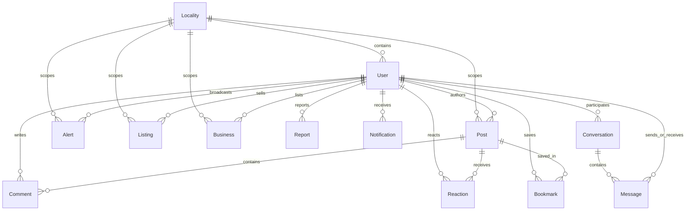

# 🏘️ Padosi — Hyperlocal Neighborhood Community Platform

[](https://padosi.omprakashmeher.in/)
[](https://opensource.org/licenses/MIT)
[](https://nodejs.org/)
[](https://react.dev/)
[](https://expressjs.com/)
[](https://www.mongodb.com/)
[](https://socket.io/)
[](https://tailwindcss.com/)

> **पड़ोसी (Padosi) · Your Neighbor · Trusted. Local. Real.**  
> A full-stack MERN hyperlocal social network connecting verified residents within Indian colonies, housing societies, apartments, and gated communities — inspired by Nextdoor and tailored for Indian urban neighborhoods.

---

### 🌐 Live Deployment
Experience Padosi live in production:  
👉 **[https://padosi.omprakashmeher.in](https://padosi.omprakashmeher.in/)**

Repository: **[https://github.com/meheromprakash/padosi](https://github.com/meheromprakash/padosi)**

---

## 📑 Table of Contents
- [Project Overview](#-project-overview)
- [Key Features](#-key-features)
- [Technology Stack](#-technology-stack)
- [System Architecture](#-system-architecture)
- [Project Directory Structure](#-project-directory-structure)
- [Database Schema & Data Models](#-database-schema--data-models)
  - [MongoDB Configuration & Transactions](#mongodb-configuration--transactions)
  - [Database Relationships (Mermaid ERD)](#database-relationships)
  - [Detailed Mongoose Models](#detailed-mongoose-models)
  - [Representative Document JSON Examples](#representative-document-json-examples)
- [API Specification](#-api-specification)
- [Real-Time Communication (Socket.IO)](#-real-time-communication-socketio)
- [Security Considerations](#-security-considerations)
- [Prerequisites & Local Setup](#-prerequisites--local-setup)
- [Environment Variables](#-environment-variables)
- [Contributing Guidelines](#-contributing-guidelines)
- [License & Author](#-license--author)

---

## 📖 Project Overview

Modern urban neighborhoods in India often suffer from digital disconnect. While residents live meters apart in colonies, sectors, or high-rise societies, community coordination remains fragmented across noisy WhatsApp groups, unmoderated forums, or informal notice boards.

**Padosi** solves this by establishing a **geofenced, verified neighborhood network** where physical proximity determines digital community:
- **Verified Locality Isolation:** Users discover and bind their accounts to specific colonies, sectors, or pincodes, ensuring discussions, marketplace listings, and directory entries remain hyper-relevant.
- **Trust-First Verification:** Combines pincode validation, colony selection, email OTP confirmation (via Resend), optional Google OAuth, and dynamic user trust scoring.
- **Urgent Broadcast Infrastructure:** Provides zero-latency emergency and utility broadcast channels powered by WebSockets to alert neighbors instantly about power outages, water cuts, or security incidents.
- **Circular Local Economy:** An integrated neighborhood classifieds engine that helps residents trade pre-owned goods, offer free items, and discover trusted neighborhood service providers (plumbers, electricians, tutors, doctors) with direct calling and WhatsApp triggers.

---

## ✨ Key Features

### 🔐 1. Smart Onboarding & Multi-Factor Auth
- **Colony & Pincode Discovery:** Search-as-you-type locality autocomplete matching against existing database communities or automatically indexing new ones.
- **Passwordless 6-Digit Email OTP:** Resend-backed OTP verification with a graceful local terminal logging fallback for instant development setup.
- **Google OAuth 2.0 Integration:** One-tap authentication using Google Identity Services with automatic account linking.
- **Neighbor Trust Score:** Dynamic algorithmic score (0–100) reflecting profile completeness, verification status, and platform engagement.

### 📰 2. Hyperlocal Community Feed
- **Locality-Scoped Stream:** Posts are strictly partitioned by colony/locality to prevent content dilution.
- **Multi-Category Filtering:** Filter feeds by `general`, `alert`, `event`, `help`, `recommendation`, or `listing`.
- **Media Attachments:** Multi-image post composition (up to 4 images) with automatic upload handling via Cloudinary or local disk fallback.
- **Atomic Reactions & Bookmarks:** Tri-state reactions (`like`, `heart`, `support`) with optimistic client updates and private bookmark collections.
- **Nested Comment Threads:** Contextual discussion threads with real-time author notification hooks.

### 🚨 3. Real-Time Safety & Utility Alerts
- **Severity-Tiered Broadcasts:** Categorized by severity (`critical`, `high`, `medium`, `low`) and alert type (`safety`, `utility`, `emergency`, `general`).
- **Push Broadcasting over WebSockets:** Emits `alert:new` instantly to all connected neighbors in the affected locality room.
- **Official & Community Alerts:** Flags verified administrator or municipal alerts to ensure urgent warnings take visual precedence.

### 🛍️ 4. Neighborhood Marketplace
- **Hyperlocal Trading:** Buy and sell second-hand furniture, electronics, books, appliances, and vehicle accessories with neighbors.
- **Giveaway ("Free") Filter:** Dedicated toggle for free neighborly giveaways.
- **Condition Grading & Status:** Detailed item conditions (`new`, `like_new`, `good`, `fair`) and inventory status (`available`, `reserved`, `sold`).

### 🛠️ 5. Verified Local Business Directory
- **Essential Trade Categories:** Curated directory for plumbers, electricians, carpenters, tutors, doctors, pharmacies, and grocery shops.
- **Direct Contact Triggers:** One-tap native phone dialing (`tel:`) and instant WhatsApp chat opening (`https://wa.me/`).
- **Community Ratings:** Aggregate ratings and review counts submitted by verified neighbors.

### 💬 6. Instant 1-on-1 Direct Messaging
- **Real-Time WebSocket Chat:** Powered by Socket.IO rooms for zero-latency private neighbor conversations.
- **Live Typing Indicators:** Broadcasts typing states (`typing:start`, `typing:stop`) between conversational peers.
- **Read Receipts & Unread Counters:** Tracks `readAt` timestamps and persists individual unread counters per participant.
- **Inbox Thread Overview:** Fast inbox loading sorted by latest interactions with partner verification badges.

### 🛡️ 7. Community Safety & Moderation
- **Universal Report System:** Flag abusive posts, comments, marketplace listings, or users directly to community moderators.
- **Soft Deletion Architecture:** Posts and comments feature logical soft deletion (`isActive: false`) preserving audit integrity and relational counts.
- **Offline UX Awareness:** Dedicated banner notification alerting users during network disconnections.

---

## 🛠️ Technology Stack

| Layer | Technologies | Description |
|---|---|---|
| **Frontend Framework** | **React 19.2**, **Vite 5.4** | Ultra-fast single-page application with code splitting via React `lazy` and `Suspense` |
| **Routing & Navigation** | **React Router DOM 6.30** | Declarative client-side routing with guarded `ProtectedRoute` wrappers |
| **Styling & Design System** | **Tailwind CSS 3.4**, **PostCSS**, **Autoprefixer** | Custom warm earthy palette (`#2D6A4F` Forest Green, `#52B788` Sage, `#FDFBF7` Warm White) |
| **Icons & Media** | **Lucide React**, Material Symbols | Clean, modern iconography across feed cards, navigation, and badges |
| **Client HTTP & Sockets** | **Axios 1.16**, **Socket.IO Client 4.8** | Centralized API client with JWT interceptors and reactive WebSocket provider |
| **Backend Framework** | **Node.js 18+**, **Express 4.18** | RESTful modular API with asynchronous handlers, transaction support, and logging |
| **Database & ODM** | **MongoDB 8.0**, **Mongoose 8.0** | Document database with 2dsphere geo-indexing, compound indexes, and ACID transactions |
| **Real-Time Engine** | **Socket.IO 4.0** | WebSocket engine with JWT handshake authentication and room partitioning |
| **Security & Auth** | **JWT**, **Bcrypt.js**, **Helmet**, **express-rate-limit** | Stateless bearer token auth, OTP salting, CSP headers, and multi-tier rate limiting |
| **File Storage** | **Cloudinary v2**, **Multer 1.4** | Cloud-hosted media pipeline with automated disk fallback for zero-config local dev |
| **Email Delivery** | **Resend 4.0** | Modern transactional email API for OTP delivery with local console output fallback |

---

## 🏛️ System Architecture

```
                          ┌─────────────────────────────────────┐
                          │         Padosi React Client         │
                          │   (React 19 + Vite + TailwindCSS)   │
                          └───────────────┬─────────────────────┘
                                          │
                        HTTP REST / JSON  │  WebSockets (Socket.IO)
                       (JWT Bearer Auth)  │ (Handshake Auth + Rooms)
                                          ▼
                          ┌─────────────────────────────────────┐
                          │         Express.js API Server       │
                          │    - Security: Helmet, RateLimit    │
                          │    - Middleware: Auth, Multer       │
                          │    - Socket.IO Room Manager         │
                          └──────┬──────────┬──────────┬────────┘
                                 │          │          │
                     Mongoose    │          │          │  REST
                   Transactions  │          │          │
                                 ▼          ▼          ▼
                       ┌─────────────┐ ┌──────────┐ ┌──────────┐
                       │   MongoDB   │ │Cloudinary│ │  Resend  │
                       │   Database  │ │  Media   │ │Email OTP │
                       └─────────────┘ └──────────┘ └──────────┘
```

---

## 📂 Project Directory Structure

```
Padosi/
├── client/                               # React + Vite Single Page Application
│   ├── public/                           # Static public web assets
│   ├── src/
│   │   ├── api/
│   │   │   └── axios.js                  # Pre-configured Axios instance with auth headers
│   │   ├── components/                   # Reusable UI component library
│   │   │   ├── AlertCard.jsx             # Safety alert visual card
│   │   │   ├── AppLayout.jsx             # Main shell layout with sidebar and responsive frame
│   │   │   ├── Avatar.jsx                # User avatar with fallback initials
│   │   │   ├── Badge.jsx                 # Category & status badges
│   │   │   ├── BottomNav.jsx             # Mobile bottom navigation bar
│   │   │   ├── BusinessCard.jsx          # Directory item card with Call & WhatsApp triggers
│   │   │   ├── EmptyState.jsx            # Empty list illustrations & messages
│   │   │   ├── ErrorBoundary.jsx         # React UI error boundary fallback
│   │   │   ├── ErrorState.jsx            # API error display component
│   │   │   ├── FAB.jsx                   # Floating action button
│   │   │   ├── FeedCard.jsx              # Community post card with reaction & comment bar
│   │   │   ├── FilterChips.jsx           # Horizontal category filter selector
│   │   │   ├── ListingCard.jsx           # Marketplace item card with price tag
│   │   │   ├── LoadingSkeleton.jsx       # Shimmer loading placeholders
│   │   │   ├── LoadingSpinner.jsx        # Full-page / inline spinner
│   │   │   ├── MobileNav.jsx             # Mobile top bar navigation
│   │   │   ├── Modal.jsx                 # Universal accessible modal dialog
│   │   │   ├── OTPInput.jsx              # 6-box OTP entry component with auto-focus
│   │   │   ├── PostComposer.jsx          # Rich post creation modal with image previews
│   │   │   ├── RightPanel.jsx            # Desktop right rail (local businesses, trending)
│   │   │   ├── SearchBar.jsx             # Debounced search input
│   │   │   ├── Sidebar.jsx               # Desktop primary navigation sidebar
│   │   │   ├── TopBar.jsx                # Desktop top header with locality title
│   │   │   └── VerifiedShield.jsx        # Trust badge for verified neighbors
│   │   ├── context/
│   │   │   ├── AuthContext.jsx           # JWT token, user profile, and login/logout state
│   │   │   ├── LocalityContext.jsx       # Current active locality and neighborhood data
│   │   │   └── SocketContext.jsx         # Socket.IO connection, room join, and live notifications
│   │   ├── hooks/                        # Custom domain hooks
│   │   │   ├── useAlerts.js              # Fetch & real-time subscribe to safety alerts
│   │   │   ├── useAuth.js                # Auth context consumer
│   │   │   ├── useBusinesses.js          # Fetch business directory listings
│   │   │   ├── useComments.js            # Post comment management
│   │   │   ├── useFeed.js                # Paginated feed queries with optimistic reactions
│   │   │   ├── useListings.js            # Marketplace query hook
│   │   │   └── useSocket.js              # Socket context consumer
│   │   ├── pages/                        # Main application views
│   │   │   ├── AddressVerification.jsx   # Onboarding: colony & address selection
│   │   │   ├── Directory.jsx             # Local business & services directory page
│   │   │   ├── EmailEntry.jsx            # Onboarding: email submission for OTP
│   │   │   ├── Feed.jsx                  # Main neighborhood feed page
│   │   │   ├── Login.jsx                 # Returning user login (OTP or Google)
│   │   │   ├── Marketplace.jsx           # Buy & sell marketplace catalog
│   │   │   ├── Messages.jsx              # 1-on-1 direct chat view
│   │   │   ├── NotFound.jsx              # 404 error page
│   │   │   ├── Notifications.jsx         # Activity notification center
│   │   │   ├── OTPVerification.jsx       # 6-digit OTP verification screen
│   │   │   ├── Onboarding.jsx            # Welcome landing & introductory screen
│   │   │   ├── Profile.jsx               # User profile, trust score, and post history
│   │   │   ├── ProfileSetup.jsx          # Initial name & avatar setup
│   │   │   ├── SafetyAlerts.jsx          # Emergency alerts dashboard
│   │   │   └── Search.jsx                # Universal search page
│   │   ├── routes/
│   │   │   └── ProtectedRoute.jsx        # Route guard checking authentication state
│   │   ├── utils/
│   │   │   ├── dateUtils.js              # Relative timestamp formatting
│   │   │   └── imageUtils.js             # Image optimization & preview helpers
│   │   ├── App.jsx                       # Root routing setup & offline status monitor
│   │   ├── index.css                     # Global styles, fonts, and Tailwind directives
│   │   └── main.jsx                      # React 19 entry point
│   ├── .env.example                      # Client environment variable template
│   ├── package.json                      # Frontend dependencies & scripts
│   ├── tailwind.config.js                # Tailwind custom theme configuration
│   └── vite.config.js                    # Vite bundler configuration
│
├── server/                               # Express.js REST API & Socket.IO Server
│   ├── controllers/                      # Request handlers & business logic
│   │   ├── alertController.js            # Fetch and broadcast emergency alerts
│   │   ├── authController.js             # OTP lifecycle, verification, Google auth, JWT
│   │   ├── bookmarkController.js         # User post bookmarking management
│   │   ├── businessController.js         # Directory listings and categorization
│   │   ├── commentController.js          # Transactional comment creation & deletion
│   │   ├── feedController.js             # Locality feed queries with reactions/bookmarks
│   │   ├── listingController.js          # Marketplace CRUD with multi-image uploads
│   │   ├── localityController.js         # Colony search and geofence resolution
│   │   ├── messageController.js          # 1-on-1 messaging & inbox thread aggregation
│   │   ├── notificationController.js     # User notification center & unread management
│   │   ├── postController.js             # Post CRUD, image uploads, atomic reactions
│   │   ├── reportController.js           # Community moderation report submission
│   │   └── userController.js             # Profile management, trust score calculation
│   ├── middleware/                       # Express middlewares
│   │   ├── auth.js                       # JWT verification and user population
│   │   ├── errorHandler.js               # Global centralized error formatting
│   │   ├── logger.js                     # HTTP request structured console logger
│   │   └── upload.js                     # Multer configuration for file uploads
│   ├── models/                           # Mongoose data schemas (13 models)
│   │   ├── Alert.js                      # Safety & emergency alerts
│   │   ├── Bookmark.js                   # Saved posts by user
│   │   ├── Business.js                   # Local businesses & services
│   │   ├── Comment.js                    # Post comments
│   │   ├── Conversation.js               # Message thread metadata & unread counts
│   │   ├── Listing.js                    # Marketplace listings
│   │   ├── Locality.js                   # Colony, city, pincode, 2dsphere location
│   │   ├── Message.js                    # Direct message instances
│   │   ├── Notification.js               # Activity notifications
│   │   ├── Post.js                       # Neighborhood feed posts
│   │   ├── Reaction.js                   # Post reactions (like, heart, support)
│   │   ├── Report.js                     # Moderation reports
│   │   └── User.js                       # User profile, auth credentials, trust score
│   ├── routes/                           # Express route definitions
│   ├── socket/
│   │   └── socketHandler.js              # Socket.IO connection, room join & typing events
│   ├── utils/                            # Shared backend helpers
│   │   ├── asyncHandler.js               # Promise wrapper removing try-catch boilerplate
│   │   ├── cloudinary.js                 # Cloudinary image upload & cleanup helpers
│   │   ├── email.js                      # Resend OTP sender with console logging fallback
│   │   ├── notifications.js              # Notification creator with real-time socket emit
│   │   └── transaction.js                # Replica-set aware MongoDB transaction runner
│   ├── .env.example                      # Server environment variable template
│   ├── package.json                      # Backend dependencies & scripts
│   └── server.js                         # Server entry point, DB connection, & Socket.IO init
│
├── .gitignore                            # Root Git ignore rules
├── LICENSE                               # MIT License
├── netlify.toml                          # Netlify client deployment configuration
├── package.json                          # Monorepo root package with concurrent dev scripts
└── README.md                             # Project documentation
```

---

## 🗄️ Database Schema & Data Models

### MongoDB Configuration & Transactions

Padosi uses **Mongoose 8.0** to connect to MongoDB. The database connection is established in `server/server.js`:

```javascript
mongoose.connect(process.env.MONGODB_URI);
```

#### Automatic ACID Transaction Detection
The server includes an automated replica-set detector (`server/utils/transaction.js`). Upon connecting, it probes the MongoDB deployment via the administrative `hello` command:
- **Replica Set / MongoDB Atlas:** Executes critical state mutations (e.g. creating comments while incrementing comment counts, or updating message unread counters) inside isolated **ACID transactions** using `session.startTransaction()`.
- **Standalone Local MongoDB:** Automatically runs mutations directly without failing on transaction prerequisites, providing seamless local developer ergonomics.

---

### Database Relationships



---

### Detailed Mongoose Models

Padosi defines **13 production models** located in `server/models/`:

#### 1. User (`models/User.js`)
*Represents a neighborhood resident, holding profile details, trust score, and authentication metadata.*

| Field | Type | Required | Default | Description |
|---|---|---|---|---|
| `firstName` | String | No | — | Resident's first name (trimmed, max 50 chars) |
| `email` | String | Yes | — | Unique, lowercase, trimmed email address |
| `avatar` | String | No | `null` | Cloudinary or static URL to profile image |
| `bio` | String | No | `""` | Short personal bio (max 200 chars) |
| `trustScore` | Number | No | `50` | Trust rating between 0 and 100 |
| `localityId` | ObjectId (`ref: Locality`) | No | `null` | Resident's verified home locality |
| `address` | String | No | `""` | Street / flat / house address |
| `city` | String | No | `""` | Resident's city |
| `pincode` | String | No | `""` | Postal code |
| `verification.otpHash` | String | No | `null` | **Security:** Bcrypt hash of OTP (`select: false`) |
| `verification.expiresAt` | Date | No | `null` | **Security:** OTP expiry date (`select: false`) |
| `verification.verified` | Boolean | No | `false` | True once email OTP is verified |
| `role` | String | No | `'user'` | Enum: `['user', 'admin', 'moderator']` |
| `isActive` | Boolean | No | `true` | Account active flag |
| `lastSeen` | Date | No | `Date.now` | Last activity timestamp |
| `googleId` | String | No | `null` | Google OAuth subject identifier |
| `provider` | String | No | `'local'` | Enum: `['local', 'google']` |
| `createdAt` / `updatedAt` | Date | Auto | `now` | Timestamps generated by Mongoose |

- **Indexes:** `{ localityId: 1 }`, `{ email: 1 }` (unique).
- **Security Method:** `toSafeObject()` strips `otpHash` and `expiresAt` before responses are sent to clients.

---

#### 2. Locality (`models/Locality.js`)
*Represents a physical colony, sector, or apartment community.*

| Field | Type | Required | Default | Description |
|---|---|---|---|---|
| `name` | String | Yes | — | Colony / locality name (e.g., "Indiranagar") |
| `city` | String | Yes | — | City name (e.g., "Bengaluru") |
| `pincode` | String | Yes | — | Postal pincode (e.g., "560038") |
| `state` | String | No | `'Gujarat'` | State name |
| `location.type` | String | No | `'Point'` | GeoJSON type enum: `['Point']` |
| `location.coordinates`| [Number] | No | `[0, 0]` | Longitude, Latitude coordinates |
| `memberCount` | Number | No | `0` | Total verified members in locality |
| `isActive` | Boolean | No | `true` | Locality active status |
| `createdAt` / `updatedAt` | Date | Auto | `now` | Automatic timestamps |

- **Indexes:** `{ location: '2dsphere' }`, Text index: `{ name: 'text', city: 'text' }`, `{ pincode: 1 }`.

---

#### 3. Post (`models/Post.js`)
*Represents a community feed post created by a resident.*

| Field | Type | Required | Default | Description |
|---|---|---|---|---|
| `content` | String | Yes | — | Post text (trimmed, max 500 chars) |
| `media` | [String] | No | `[]` | Array of Cloudinary/storage image URLs |
| `localityId` | ObjectId (`ref: Locality`) | Yes | — | Locality boundary for the post |
| `authorId` | ObjectId (`ref: User`) | Yes | — | Reference to author resident |
| `category` | String | No | `'general'` | Enum: `['general', 'alert', 'event', 'help', 'recommendation', 'listing']` |
| `reactions.like` | Number | No | `0` | Count of like reactions |
| `reactions.heart` | Number | No | `0` | Count of heart reactions |
| `reactions.support` | Number | No | `0` | Count of support reactions |
| `commentsCount` | Number | No | `0` | Total active comments counter |
| `isActive` | Boolean | No | `true` | Soft delete flag |
| `createdAt` / `updatedAt` | Date | Auto | `now` | Automatic timestamps |

- **Indexes:** `{ localityId: 1, category: 1, createdAt: -1 }`, `{ localityId: 1, isActive: 1, createdAt: -1 }`, `{ authorId: 1 }`, `{ authorId: 1, createdAt: -1 }`.

---

#### 4. Comment (`models/Comment.js`)
*Represents a comment replying to a community post.*

| Field | Type | Required | Default | Description |
|---|---|---|---|---|
| `postId` | ObjectId (`ref: Post`) | Yes | — | Reference to parent post |
| `authorId` | ObjectId (`ref: User`) | Yes | — | Reference to commenter |
| `content` | String | Yes | — | Comment text (trimmed, max 300 chars) |
| `isActive` | Boolean | No | `true` | Soft delete flag |
| `createdAt` / `updatedAt` | Date | Auto | `now` | Automatic timestamps |

- **Indexes:** `{ postId: 1, isActive: 1, createdAt: 1 }`.

---

#### 5. Reaction (`models/Reaction.js`)
*Tracks resident reactions on posts to ensure unique, togglable reactions.*

| Field | Type | Required | Default | Description |
|---|---|---|---|---|
| `postId` | ObjectId (`ref: Post`) | Yes | — | Reference to post |
| `userId` | ObjectId (`ref: User`) | Yes | — | Reference to reacting resident |
| `type` | String | No | `'like'` | Enum: `['like', 'heart', 'support']` |
| `createdAt` / `updatedAt` | Date | Auto | `now` | Automatic timestamps |

- **Indexes:** `{ postId: 1, userId: 1 }` (**Unique constraint** preventing duplicate user reactions), `{ userId: 1, postId: 1 }`.

---

#### 6. Bookmark (`models/Bookmark.js`)
*Stores user saved posts for quick personal reference.*

| Field | Type | Required | Default | Description |
|---|---|---|---|---|
| `userId` | ObjectId (`ref: User`) | Yes | — | Reference to resident saving the post |
| `postId` | ObjectId (`ref: Post`) | Yes | — | Reference to saved post |
| `createdAt` / `updatedAt` | Date | Auto | `now` | Automatic timestamps |

- **Indexes:** `{ userId: 1, postId: 1 }` (**Unique constraint**), `{ userId: 1, createdAt: -1 }`.

---

#### 7. Alert (`models/Alert.js`)
*Represents a community safety warning or municipal utility notice.*

| Field | Type | Required | Default | Description |
|---|---|---|---|---|
| `type` | String | No | `'general'` | Enum: `['safety', 'utility', 'emergency', 'general']` |
| `severity` | String | No | `'medium'` | Enum: `['critical', 'high', 'medium', 'low']` |
| `title` | String | Yes | — | Alert headline (max 100 chars) |
| `description` | String | Yes | — | Alert details (max 500 chars) |
| `localityId` | ObjectId (`ref: Locality`) | Yes | — | Targeted locality |
| `authorId` | ObjectId (`ref: User`) | Yes | — | Alert creator reference |
| `isOfficial` | Boolean | No | `false` | Verified official alert flag |
| `notifiedCount` | Number | No | `0` | Number of broadcast recipients |
| `isActive` | Boolean | No | `true` | Active status flag |
| `expiresAt` | Date | No | `null` | Alert expiration timestamp |
| `createdAt` / `updatedAt` | Date | Auto | `now` | Automatic timestamps |

- **Indexes:** `{ localityId: 1, createdAt: -1 }`, `{ severity: 1 }`.

---

#### 8. Listing (`models/Listing.js`)
*Represents an item in the neighborhood buy & sell marketplace.*

| Field | Type | Required | Default | Description |
|---|---|---|---|---|
| `title` | String | Yes | — | Item title (max 100 chars) |
| `description` | String | No | `""` | Item description (max 500 chars) |
| `price` | Number | No | `0` | Price in INR (minimum: 0) |
| `isFree` | Boolean | No | `false` | True for neighborhood giveaways |
| `category` | String | No | `'other'` | Enum: `['electronics', 'furniture', 'clothing', 'books', 'vehicles', 'toys', 'kitchen', 'other']` |
| `condition` | String | No | `'good'` | Enum: `['new', 'like_new', 'good', 'fair']` |
| `images` | [String] | No | `[]` | Array of item photo URLs |
| `localityId` | ObjectId (`ref: Locality`) | Yes | — | Locality of the seller |
| `sellerId` | ObjectId (`ref: User`) | Yes | — | Seller resident reference |
| `status` | String | No | `'available'` | Enum: `['available', 'sold', 'reserved']` |
| `createdAt` / `updatedAt` | Date | Auto | `now` | Automatic timestamps |

- **Indexes:** `{ localityId: 1, createdAt: -1 }`, `{ sellerId: 1 }`, `{ category: 1, status: 1 }`.

---

#### 9. Business (`models/Business.js`)
*Represents a local service provider or neighborhood merchant.*

| Field | Type | Required | Default | Description |
|---|---|---|---|---|
| `name` | String | Yes | — | Business/service name (max 100 chars) |
| `category` | String | Yes | — | Enum: `['plumber', 'electrician', 'carpenter', 'doctor', 'restaurant', 'grocery', 'pharmacy', 'salon', 'gym', 'tutor', 'other']` |
| `localityId` | ObjectId (`ref: Locality`) | No | — | Locality reference |
| `addedBy` | ObjectId (`ref: User`) | No | — | Resident who recommended/added the business |
| `rating` | Number | No | `0` | Rating from 0 to 5 |
| `reviewCount` | Number | No | `0` | Count of reviews |
| `isVerified` | Boolean | No | `false` | Verified provider badge |
| `contact` | String | No | `null` | Phone number for native calling |
| `whatsapp` | String | No | `null` | WhatsApp contact number |
| `address` | String | No | `""` | Physical shop address |
| `description` | String | No | `""` | Short description (max 300 chars) |
| `isActive` | Boolean | No | `true` | Active status flag |
| `createdAt` / `updatedAt` | Date | Auto | `now` | Automatic timestamps |

- **Indexes:** `{ localityId: 1 }`, `{ category: 1 }`, Text index: `{ name: 'text' }`.

---

#### 10. Conversation (`models/Conversation.js`)
*Represents a direct messaging thread between two neighbors.*

| Field | Type | Required | Default | Description |
|---|---|---|---|---|
| `participants` | [ObjectId (`ref: User`)] | Yes | — | Array of participant User IDs |
| `lastMessageId` | ObjectId (`ref: Message`) | No | `null` | Pointer to latest message |
| `unreadCounts` | Map of Number | No | `{}` | Key-value map: `userId -> unreadCount` |
| `createdAt` / `updatedAt` | Date | Auto | `now` | Automatic timestamps |

- **Indexes:** `{ participants: 1, updatedAt: -1 }`.

---

#### 11. Message (`models/Message.js`)
*Represents an individual chat message within a conversation.*

| Field | Type | Required | Default | Description |
|---|---|---|---|---|
| `conversationId` | ObjectId (`ref: Conversation`) | Yes | — | Parent conversation thread |
| `senderId` | ObjectId (`ref: User`) | Yes | — | Sending resident ID |
| `receiverId` | ObjectId (`ref: User`) | Yes | — | Receiving resident ID |
| `content` | String | Yes | — | Message content (max 1000 chars) |
| `readAt` | Date | No | `null` | Timestamp when read by receiver |
| `isDeleted` | Boolean | No | `false` | Soft delete flag |
| `createdAt` / `updatedAt` | Date | Auto | `now` | Automatic timestamps |

- **Indexes:** `{ conversationId: 1, createdAt: -1 }`, `{ conversationId: 1, receiverId: 1, readAt: 1 }`.

---

#### 12. Notification (`models/Notification.js`)
*Stores user activity alerts (likes, comments, messages, alerts).*

| Field | Type | Required | Default | Description |
|---|---|---|---|---|
| `recipientId` | ObjectId (`ref: User`) | Yes | — | User receiving notification |
| `senderId` | ObjectId (`ref: User`) | Yes | — | User triggering notification |
| `type` | String | Yes | — | Enum: `['like', 'comment', 'message', 'alert', 'system']` |
| `entityId` | ObjectId | Yes | — | Referenced document ID |
| `entityType` | String | Yes | — | Enum: `['Post', 'Comment', 'Message', 'Alert']` |
| `content` | String | Yes | — | Notification message text |
| `isRead` | Boolean | No | `false` | Read status |
| `createdAt` / `updatedAt` | Date | Auto | `now` | Automatic timestamps |

- **Indexes:** `{ recipientId: 1, isRead: 1 }`, `{ recipientId: 1, createdAt: -1 }`.

---

#### 13. Report (`models/Report.js`)
*Moderation reports submitted by residents for platform safety.*

| Field | Type | Required | Default | Description |
|---|---|---|---|---|
| `reporterId` | ObjectId (`ref: User`) | Yes | — | Resident filing the report |
| `targetId` | ObjectId | Yes | — | ID of reported entity |
| `targetType` | String | Yes | — | Enum: `['Post', 'Comment', 'User', 'Listing']` |
| `reason` | String | Yes | — | Report explanation (max 200 chars) |
| `status` | String | No | `'pending'` | Enum: `['pending', 'resolved']` |
| `createdAt` / `updatedAt` | Date | Auto | `now` | Automatic timestamps |

- **Indexes:** `{ status: 1 }`, `{ targetId: 1 }`.

---

### Representative Document JSON Examples

#### User Document (Safe API Output)
```json
{
  "_id": "664f1a2b3c4d5e6f7a8b9c01",
  "firstName": "Aarav",
  "email": "aarav.patel@example.com",
  "avatar": "https://res.cloudinary.com/demo/image/upload/v1716000000/padosi/avatars/user_1.jpg",
  "bio": "Resident at Block B since 2021. Plant lover & weekend cyclist.",
  "trustScore": 85,
  "localityId": {
    "_id": "664f199a3c4d5e6f7a8b9bf5",
    "name": "Shantinagar Colony",
    "city": "Ahmedabad",
    "pincode": "380013"
  },
  "address": "Flat 402, Block B, Green Heights",
  "city": "Ahmedabad",
  "pincode": "380013",
  "role": "user",
  "isActive": true,
  "provider": "local",
  "verification": {
    "verified": true
  },
  "createdAt": "2026-06-15T08:30:00.000Z",
  "updatedAt": "2026-07-01T11:45:00.000Z"
}
```

#### Community Post Document
```json
{
  "_id": "664f201b3c4d5e6f7a8b9d20",
  "content": "Does anyone know a reliable carpenter available this weekend for wooden door repairs?",
  "category": "recommendation",
  "media": [
    "https://res.cloudinary.com/demo/image/upload/v1716000000/padosi/posts/door_photo.jpg"
  ],
  "localityId": "664f199a3c4d5e6f7a8b9bf5",
  "authorId": {
    "_id": "664f1a2b3c4d5e6f7a8b9c01",
    "firstName": "Aarav",
    "avatar": "https://res.cloudinary.com/demo/image/upload/v1716000000/padosi/avatars/user_1.jpg",
    "verification": { "verified": true }
  },
  "reactions": {
    "like": 4,
    "heart": 1,
    "support": 2
  },
  "commentsCount": 3,
  "isActive": true,
  "userReaction": "like",
  "userBookmarked": false,
  "createdAt": "2026-07-10T14:20:00.000Z"
}
```

#### Safety Alert Document
```json
{
  "_id": "664f315c3c4d5e6f7a8b9e11",
  "title": "Scheduled Power Outage: Block A & B",
  "description": "Torrent Power announced maintenance shutdown on Saturday between 10:00 AM and 2:00 PM.",
  "type": "utility",
  "severity": "high",
  "localityId": "664f199a3c4d5e6f7a8b9bf5",
  "authorId": {
    "_id": "664f1a2b3c4d5e6f7a8b9c01",
    "firstName": "Aarav",
    "avatar": null,
    "verification": { "verified": true }
  },
  "isOfficial": true,
  "notifiedCount": 142,
  "isActive": true,
  "createdAt": "2026-07-12T09:00:00.000Z"
}
```

#### Marketplace Listing Document
```json
{
  "_id": "664f408d3c4d5e6f7a8b9f33",
  "title": "Solid Sheesham Wood Study Table with Drawer",
  "description": "2 years old, excellent condition. Selling due to relocation.",
  "price": 2800,
  "isFree": false,
  "category": "furniture",
  "condition": "good",
  "images": [
    "https://res.cloudinary.com/demo/image/upload/v1716000000/padosi/listings/table_1.jpg"
  ],
  "localityId": "664f199a3c4d5e6f7a8b9bf5",
  "sellerId": {
    "_id": "664f1a2b3c4d5e6f7a8b9c01",
    "firstName": "Aarav",
    "avatar": null,
    "verification": { "verified": true }
  },
  "status": "available",
  "createdAt": "2026-07-14T16:15:00.000Z"
}
```

---

## 📡 API Specification

All API endpoints are mounted at `/api` and return standardized JSON responses.

### 1. Authentication (`/api/auth`)
| Method | Endpoint | Auth | Rate Limit | Description |
|---|---|---|---|---|
| `POST` | `/api/auth/start-signup` | Public | 5/15m (50 in dev) | Initiates signup, creates locality if new, hashes OTP, triggers email/console |
| `POST` | `/api/auth/verify-otp` | Public | 5/15m (50 in dev) | Validates 6-digit OTP, increments memberCount, issues 30-day JWT |
| `POST` | `/api/auth/login-otp` | Public | 5/15m (50 in dev) | Generates and sends OTP for an existing verified account |
| `POST` | `/api/auth/login` | Public | 5/15m (50 in dev) | Verifies login OTP and returns JWT token + user profile |
| `POST` | `/api/auth/logout` | Public | Global | Clears client session acknowledgment |
| `POST` | `/api/auth/google` | Public | Global | Authenticates Google credential token, links or creates profile |

### 2. User Profile (`/api/users`)
| Method | Endpoint | Auth | Description |
|---|---|---|---|
| `GET` | `/api/users/me` | Bearer JWT | Returns current authenticated user profile populated with locality |
| `PUT` | `/api/users/me` | Bearer JWT | Updates profile details, address, locality, and uploads avatar image |

### 3. Locality Feed (`/api/feed`)
| Method | Endpoint | Auth | Description |
|---|---|---|---|
| `GET` | `/api/feed` | Bearer JWT | Returns paginated posts for user's locality (`page`, `limit`, `category`, `q`) |

### 4. Posts & Comments (`/api/posts`)
| Method | Endpoint | Auth | Description |
|---|---|---|---|
| `POST` | `/api/posts` | Bearer JWT | Creates new post with multipart image uploads (up to 4 media files) |
| `GET` | `/api/posts/:id` | Bearer JWT | Retrieves single post with user reaction status |
| `PUT` | `/api/posts/:id` | Bearer JWT | Updates post content and category (author only) |
| `DELETE` | `/api/posts/:id` | Bearer JWT | Soft deletes post (`isActive: false`, author only) |
| `POST` | `/api/posts/:id/react` | Bearer JWT | Toggles/switches reaction (`like`, `heart`, `support`) & triggers notification |
| `GET` | `/api/posts/:postId/comments` | Bearer JWT | Returns paginated comment thread for a post |
| `POST` | `/api/posts/:postId/comments` | Bearer JWT | Appends comment, increments post comment count, notifies author |
| `DELETE` | `/api/posts/:postId/comments/:commentId` | Bearer JWT | Soft deletes comment, decrements post comment count |

### 5. Bookmarks (`/api/bookmarks`)
| Method | Endpoint | Auth | Description |
|---|---|---|---|
| `GET` | `/api/bookmarks` | Bearer JWT | Retrieves user's bookmarked posts |
| `POST` | `/api/bookmarks/:postId` | Bearer JWT | Saves post to user bookmarks |
| `DELETE` | `/api/bookmarks/:postId` | Bearer JWT | Removes post from bookmarks |

### 6. Safety Alerts (`/api/alerts`)
| Method | Endpoint | Auth | Description |
|---|---|---|---|
| `GET` | `/api/alerts` | Bearer JWT | Retrieves active alerts for user's locality (optional `severity` filter) |
| `POST` | `/api/alerts` | Bearer JWT | Publishes emergency alert and broadcasts `alert:new` via WebSockets |

### 7. Marketplace (`/api/listings`)
| Method | Endpoint | Auth | Description |
|---|---|---|---|
| `GET` | `/api/listings` | Bearer JWT | Returns paginated locality listings (`category`, `isFree`, `page`, `limit`) |
| `POST` | `/api/listings` | Bearer JWT | Creates item listing with multipart image upload (up to 4 images) |
| `PUT` | `/api/listings/:id` | Bearer JWT | Updates listing status (`available`, `reserved`, `sold`) or details |
| `DELETE` | `/api/listings/:id` | Bearer JWT | Removes listing (seller only) |

### 8. Business Directory (`/api/businesses`)
| Method | Endpoint | Auth | Description |
|---|---|---|---|
| `GET` | `/api/businesses` | Bearer JWT | Returns locality business listings with category & text query filters |
| `POST` | `/api/businesses` | Bearer JWT | Recommends/adds local business with contact & WhatsApp numbers |

### 9. Direct Messaging (`/api/messages`)
| Method | Endpoint | Auth | Description |
|---|---|---|---|
| `GET` | `/api/messages/conversations` | Bearer JWT | Fetches active conversation threads with unread counts and last messages |
| `GET` | `/api/messages/:userId` | Bearer JWT | Retrieves message history with partner and marks incoming messages as read |
| `POST` | `/api/messages` | Bearer JWT | Sends direct message, updates thread metadata, emits `message:receive` |

### 10. Notifications (`/api/notifications`)
| Method | Endpoint | Auth | Description |
|---|---|---|---|
| `GET` | `/api/notifications` | Bearer JWT | Paginated list of user activity notifications |
| `PUT` | `/api/notifications/:id/read` | Bearer JWT | Marks single notification as read |
| `PUT` | `/api/notifications/read-all` | Bearer JWT | Marks all notifications as read |

### 11. Localities & Moderation (`/api/localities`, `/api/reports`)
| Method | Endpoint | Auth | Description |
|---|---|---|---|
| `GET` | `/api/localities/search` | Public | Autocomplete search matching locality name, city, or pincode |
| `GET` | `/api/localities/:id` | Public | Fetches locality details |
| `POST` | `/api/reports` | Bearer JWT | Submits moderation report on post, comment, listing, or user |
| `GET` | `/health` | Public | Server uptime, MongoDB connection status, version, and server time |

---

## ⚡ Real-Time Communication (Socket.IO)

Padosi uses WebSockets via **Socket.IO 4.x** to deliver real-time features.

### 1. Connection Authentication Middleware
Every WebSocket handshake is secured with JWT verification in `server/socket/socketHandler.js`:

```javascript
io.use(async (socket, next) => {
  const token = socket.handshake.auth?.token;
  if (!token) return next(new Error('Authentication required'));
  const decoded = jwt.verify(token, process.env.JWT_SECRET);
  const user = await User.findById(decoded.userId).lean();
  if (!user) return next(new Error('User not found'));
  socket.userId = user._id.toString();
  socket.localityId = user.localityId?.toString();
  next();
});
```

### 2. Room Architecture
Upon authentication, sockets join two isolated rooms:
- **Personal Room (`user:${userId}`):** Receives direct messages, comment reply notifications, and typing indicators.
- **Locality Room (`locality:${localityId}`):** Receives colony-wide emergency alerts and online member lists.

### 3. Socket Event Reference

| Event Name | Direction | Payload | Description |
|---|---|---|---|
| `join:locality` | Client → Server | `localityId: string` | Subscribes socket to a locality room |
| `typing:start` | Client → Server | `{ receiverId: string }` | Relays typing start state to recipient |
| `typing:stop` | Client → Server | `{ receiverId: string }` | Relays typing stop state to recipient |
| `users:online` | Server → Client | `string[]` (userIds) | Emits active user IDs within current locality |
| `message:receive` | Server → Client | `Message` object | Delivers instant direct message to recipient |
| `alert:new` | Server → Client | `Alert` object | Broadcasts urgent safety alert to all locality members |
| `notification` | Server → Client | `Notification` object | Pushes real-time reaction or comment notification |

---

## 🔒 Security Considerations

1. **Multi-Tiered Rate Limiting:**
   - **Global Rate Limiter:** 200 requests per 15 minutes per IP protecting general endpoints.
   - **Strict OTP Limiter:** Limits OTP creation to 5 attempts per 15 minutes in production (50 in development) to prevent SMS/email flooding.
2. **Credential Sanitization:**
   - OTP hash and expiration timestamp fields (`verification.otpHash`, `verification.expiresAt`) are explicitly marked `{ select: false }` in Mongoose.
   - `User.toSafeObject()` strips verification secrets before returning user objects to clients.
3. **Passwordless OTP Salting:**
   - 6-digit verification codes are hashed using `bcryptjs` (salt rounds: 10) before database storage.
4. **Header Protection & CORS:**
   - Hardened with `helmet({ crossOriginResourcePolicy: { policy: 'cross-origin' } })`.
   - Strict CORS origin whitelisting matching `CLIENT_URL`.
5. **Ownership & Access Control:**
   - Posts, comments, and listings enforce author/seller ownership validation before edit or delete actions.
   - Comments can be deleted by either the comment author or the original post author.
6. **Graceful Error Handling:**
   - Production error responses omit stack traces and sensitive database driver errors through centralized middleware (`server/middleware/errorHandler.js`).

---

## 💻 Prerequisites & Local Setup

### Prerequisites
- **Node.js:** v18.0.0 or higher
- **npm:** v9.0.0 or higher
- **MongoDB:** Local MongoDB daemon (`mongod`) or a [MongoDB Atlas](https://www.mongodb.com/atlas) cluster URI
- *(Optional)* **Resend Account:** Free API key from [resend.com](https://resend.com) for sending actual emails.
- *(Optional)* **Cloudinary Account:** Free cloud storage from [cloudinary.com](https://cloudinary.com) for image hosting.

---

### Step-by-Step Installation

#### 1. Clone the Repository
```bash
git clone https://github.com/meheromprakash/padosi.git
cd padosi
```

#### 2. Configure Environment Files
Copy the example environment files for both client and server:

```bash
# Frontend environment
cp client/.env.example client/.env

# Backend environment
cp server/.env.example server/.env
```

#### 3. Install All Dependencies
Install root, client, and server dependencies in one command:
```bash
npm run install-all
```

*(Alternatively, run manually: `npm install && cd client && npm install && cd ../server && npm install`)*

#### 4. Start Local Development
Run both frontend and backend development servers concurrently:
```bash
npm run dev
```

- **Frontend Client:** [http://localhost:5173](http://localhost:5173)
- **Backend API:** [http://localhost:5000](http://localhost:5000)
- **API Health Check:** [http://localhost:5000/health](http://localhost:5000/health)

> 💡 **Developer Convenience Tip (Zero External API Setup):**
> - **OTP without Resend:** If `RESEND_API_KEY` is not provided, OTP codes are printed directly to your server terminal console in a formatted box.
> - **Uploads without Cloudinary:** If Cloudinary keys are omitted, uploaded images fall back to the local `server/uploads/` directory automatically.

---

## 🔑 Environment Variables

### Client Configuration (`client/.env`)

| Variable | Required | Default | Description |
|---|---|---|---|
| `VITE_API_URL` | Yes | `http://localhost:5000/api` | Base URL for the Express backend REST API |
| `VITE_SOCKET_URL` | Yes | `http://localhost:5000` | URL for the backend Socket.IO WebSocket server |
| `VITE_GOOGLE_CLIENT_ID` | Optional | — | Google OAuth 2.0 Web Client ID for Google login |

### Server Configuration (`server/.env`)

| Variable | Required | Default | Description |
|---|---|---|---|
| `NODE_ENV` | No | `development` | Environment mode (`development` or `production`) |
| `PORT` | No | `5000` | HTTP port for the Express server |
| `MONGODB_URI` | Yes | `mongodb://localhost:27017/padosi` | MongoDB local connection string or Atlas URI |
| `JWT_SECRET` | Yes | `your_super_secret_jwt_key` | Secret string for signing and verifying JSON Web Tokens |
| `JWT_EXPIRES_IN` | No | `30d` | JWT token validity duration |
| `CLIENT_URL` | Yes | `http://localhost:5173` | Allowed CORS origin (frontend URL) |
| `RESEND_API_KEY` | Optional | — | Resend API key (`re_...`). If omitted, prints OTP to console |
| `EMAIL_FROM` | No | `onboarding@resend.dev` | Sender email address displayed in OTP emails |
| `CLOUDINARY_CLOUD_NAME` | Optional | — | Cloudinary cloud identifier. If omitted, falls back to disk |
| `CLOUDINARY_API_KEY` | Optional | — | Cloudinary API key |
| `CLOUDINARY_API_SECRET` | Optional | — | Cloudinary API secret |
| `GOOGLE_CLIENT_ID` | Optional | — | Google OAuth Client ID for verifying Google ID tokens |

---

## 🤝 Contributing Guidelines

Contributions are welcome! Please follow these steps:

1. **Fork the Repository:** Click the **Fork** button on [GitHub](https://github.com/meheromprakash/padosi).
2. **Create a Feature Branch:**
   ```bash
   git checkout -b feature/amazing-feature
   ```
3. **Commit Your Changes:**
   Use conventional commits:
   ```bash
   git commit -m "feat: add community polls component"
   ```
4. **Push to Your Branch:**
   ```bash
   git push origin feature/amazing-feature
   ```
5. **Open a Pull Request:** Describe your changes clearly with screenshots or test notes.

---

## 📄 License & Author

### License
This project is licensed under the **MIT License** — see the [LICENSE](LICENSE) file for details.

### Author
**Meher Omprakash**  
- **GitHub:** [@meheromprakash](https://github.com/meheromprakash)  
- **Live Website:** [https://padosi.omprakashmeher.in](https://padosi.omprakashmeher.in/)

---

<p align="center">
  Built with ❤️ for neighborhood communities across India.
</p>
